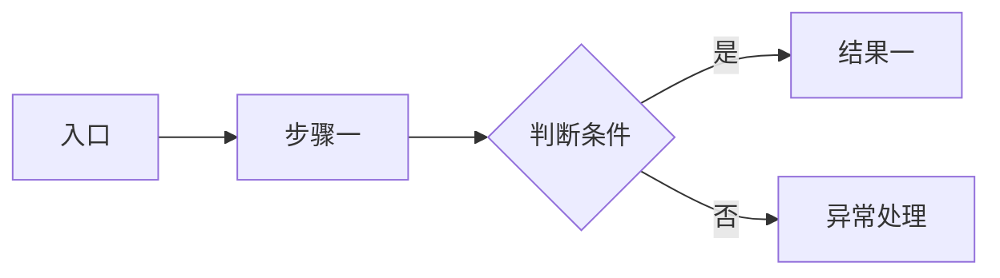
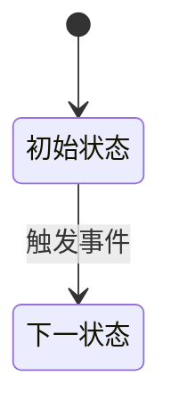

# <产品/功能名称> 产品需求文档

> 文档版本：v0.1 ｜ 状态：草稿 ｜ 最后更新：YYYY-MM-DD ｜ 负责人：<姓名>
> 适用范围：<本 PRD 覆盖的版本/端/区域>
> 优先级定义：P0 = 不实现则无法上线 ｜ P1 = 影响核心体验，本期必须 ｜ P2 = 锦上添花，可延后 ｜ P3 = 已知不做

## 0. 文档信息与变更记录

### 变更记录

| 版本 | 日期 | 修改人 | 变更内容 | 影响的需求 ID |
|---|---|---|---|---|
| v0.1 | YYYY-MM-DD | <姓名> | 初稿 | — |

### 评审记录

| 角色 | 姓名 | 结论 | 待办 | 日期 |
|---|---|---|---|---|
| 业务方 | | 待评审 | | |
| 研发负责人 | | 待评审 | | |
| 测试负责人 | | 待评审 | | |
| 设计 | | 待评审 | | |

## 1. 背景与目标

### 1.1 问题陈述

<当前存在什么问题，谁在什么场景下遇到，造成什么可量化的损失。用事实与数字，不用形容词。>

反例：用户操作很不方便，体验较差。
正例：<角色> 完成 <任务> 平均需要 7 次页面跳转、约 4 分钟，客服工单中该流程相关投诉占 23%（数据来源：2026 Q3 工单系统）。

### 1.2 目标用户与场景

| 角色 | 场景 | 当前做法 | 痛点 |
|---|---|---|---|
| | | | |

### 1.3 业务目标与成功指标

| 指标 | 当前基线 | 目标值 | 观测方式 | 观测周期 |
|---|---|---|---|---|
| | | | | |

> 至少一条指标必须能在上线后 4 周内观测到变化。全部指标都需要跨季度才能验证时，说明本次拆解过粗。

### 1.4 非目标（Out of Scope）

- 本次**不做**：<明确排除项> —— 原因：<为什么不在本期>
- 本次**不做**：<明确排除项> —— 原因：<为什么不在本期>
- 后续版本考虑：<已知的未来方向，不作为本期验收依据>

## 2. 用户故事与主流程

### 2.1 用户故事

| 编号 | 用户故事 | 关联目标 | 优先级 |
|---|---|---|---|
| US-001 | 作为 <角色>，我希望 <能力>，以便 <获得的价值> | | P0 |

### 2.2 主流程

### 2.3 异常流程

| 编号 | 触发条件 | 系统行为 | 用户可见反馈 |
|---|---|---|---|
| EX-001 | | | |

## 3. 功能需求

> 每条需求一个可独立验收的行为。出现「并且」「同时支持」时拆成多条。

### FR-001 <需求名称>

- **优先级**：P0
- **关联**：US-001 ｜ 指标：<1.3 中的指标名>
- **描述**：<系统必须在什么条件下执行什么行为。主语是系统。>
- **业务规则**：
  1. <规则，可判定真假>
  2. <规则，可判定真假>
- **输入与校验**：
  | 字段 | 类型 | 必填 | 约束 | 校验失败行为 |
  |---|---|---|---|---|
- **异常与边界**：
  | 场景 | 系统行为 | 用户可见反馈 |
  |---|---|---|
  | <异常输入> | | |
  | <并发/超时/超限> | | |
- **验收标准**：
  - [ ] Given <前置条件>, When <操作>, Then <可观测结果>
  - [ ] Given <前置条件>, When <操作>, Then <可观测结果>
- **埋点**：<事件名，详见第 6 章>

### FR-002 <需求名称>

- **优先级**：P1
- **关联**：
- **描述**：
- **业务规则**：
- **异常与边界**：
- **验收标准**：
  - [ ] Given , When , Then

## 4. 业务规则与状态机

> 跨多条 FR 的全局规则、状态流转、权限矩阵集中在此，避免散落在各条需求里造成冲突。

### 4.1 全局业务规则

| 编号 | 规则 | 适用范围 | 违反时的系统行为 |
|---|---|---|---|
| BR-001 | | | |

### 4.2 状态机

| 当前状态 | 触发事件 | 目标状态 | 前置条件 | 副作用 |
|---|---|---|---|---|

### 4.3 权限矩阵

| 角色 | 查看 | 创建 | 编辑 | 删除 | 导出 |
|---|---|---|---|---|---|
| | | | | | |

## 5. 非功能需求

> 每一条都必须带数值。写不出数值的标注「待压测确定」并列入第 7 章开放问题。

| 编号 | 类别 | 指标 | 目标值 | 测量条件 | 验证方式 |
|---|---|---|---|---|---|
| NFR-001 | 性能 | 接口 P95 响应时间 | ≤ 300 ms | 单接口 100 QPS | 压测报告 |
| NFR-002 | 性能 | 页面首屏加载 | ≤ 1.5 s | 4G 网络 | 真机测量 |
| NFR-003 | 容量 | 单租户数据量上限 | 100 万条 | — | 容量测试 |
| NFR-004 | 可用性 | 月度可用性 | ≥ 99.9% | 排除计划内维护 | 监控统计 |
| NFR-005 | 安全 | 敏感字段 | 传输与存储均加密 | — | 安全评审 |
| NFR-006 | 合规 | 个人信息处理 | 符合《个人信息保护法》告知同意要求 | — | 法务确认 |
| NFR-007 | 兼容性 | 支持范围 | Chrome 100+、iOS 15+、Android 10+ | — | 兼容性测试 |

## 6. 数据与埋点需求

### 6.1 埋点事件

| 事件名 | 触发时机 | 关键属性 | 用途（对应哪个指标） |
|---|---|---|---|
| | | | |

### 6.2 数据口径

| 指标 | 计算口径 | 数据源 | 更新频率 |
|---|---|---|---|

## 7. 依赖、风险与开放问题

### 7.1 依赖

| 编号 | 依赖对象 | 依赖内容 | 提供方 | 就绪时间 | 未就绪时的降级方案 |
|---|---|---|---|---|---|
| DEP-001 | | | | | |

### 7.2 风险

| 编号 | 风险描述 | 概率 | 影响 | 应对措施 | 负责人 |
|---|---|---|---|---|---|
| RISK-001 | | 高/中/低 | 高/中/低 | | |

### 7.3 开放问题

> 所有未确认的假设必须落在这张表里，不允许藏在正文中当作既定事实。

| 编号 | 问题 | 当前假设 | 阻塞程度 | 负责人 | 期望确认时间 |
|---|---|---|---|---|---|
| Q-001 | | | 阻塞上线 / 不阻塞 | | |

## 8. 需求追踪矩阵

> 每条 FR 必须至少对应一个测试用例。上线前用这张表逐行对账。

| 需求 ID | 关联目标 | 用户故事 | 开发任务 | 测试用例 | 状态 |
|---|---|---|---|---|---|
| FR-001 | | US-001 | | TC-001 | 待开发 |
| FR-002 | | | | | 待开发 |

---

## 术语表

| 术语 | 定义 | 备注 |
|---|---|---|
| | | |
