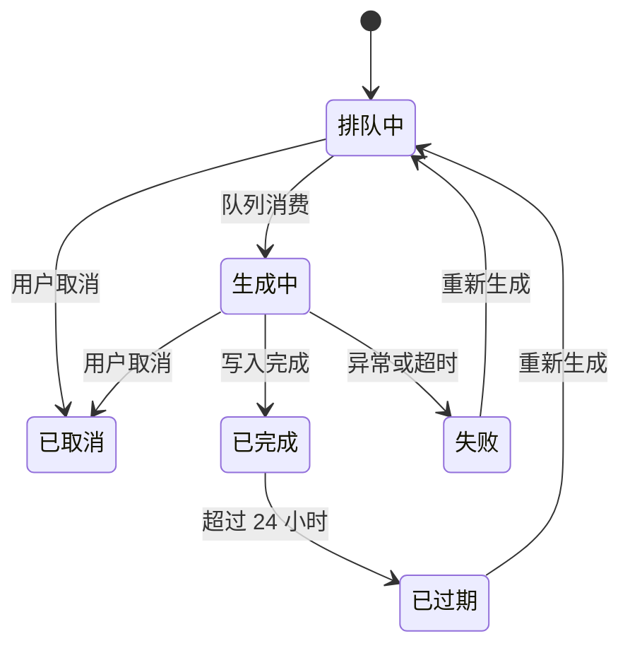

# 订单批量导出 产品需求文档

> 文档版本：v1.2 ｜ 状态：已确认 ｜ 最后更新：2026-11-08 ｜ 负责人：李衡
> 适用范围：Web 端商家后台 v3.4，中国大陆区域
> 优先级定义：P0 = 不实现则无法上线 ｜ P1 = 影响核心体验，本期必须 ｜ P2 = 锦上添花，可延后 ｜ P3 = 已知不做

## 0. 文档信息与变更记录

### 变更记录

| 版本 | 日期 | 修改人 | 变更内容 | 影响的需求 ID |
|---|---|---|---|---|
| v1.0 | 2026-10-28 | 李衡 | 初稿 | — |
| v1.1 | 2026-11-03 | 李衡 | 按研发评审补充幂等与并发处理 | FR-001、FR-002 |
| v1.2 | 2026-11-08 | 李衡 | 补充权限校验需求，明确异步上限 | FR-003、FR-004 |

### 评审记录

| 角色 | 姓名 | 结论 | 待办 | 日期 |
|---|---|---|---|---|
| 业务方 | 陈默 | 通过 | 无 | 2026-11-07 |
| 研发负责人 | 周野 | 通过 | 关注导出任务队列积压 | 2026-11-07 |
| 测试负责人 | 苏晴 | 通过 | 补充 10 万条数据量的性能用例 | 2026-11-08 |
| 设计 | 林岚 | 通过 | 无 | 2026-11-06 |

## 1. 背景与目标

### 1.1 问题陈述

商家在月末对账时需要把订单明细导出到本地财务系统。当前后台只支持"按页导出"，单次最多 50 条，商家需重复操作并手工合并。根据 2026 Q3 客服工单统计，导出相关工单共 1,847 条，占商家后台工单总量的 19.3%，其中 62% 为"能否一次性导出全部订单"。

对 30 家头部商家的访谈显示，单店月均订单量为 8,000 至 45,000 条，按月均 1.2 万条计，每次对账需导出 240 次、合并 240 个文件，平均耗时 3 小时 40 分钟。

### 1.2 目标用户与场景

| 角色 | 场景 | 当前做法 | 痛点 |
|---|---|---|---|
| 商家财务 | 月末对账，需全量订单明细 | 分页导出 240 次后手工合并 Excel | 耗时 3 小时以上，合并过程易出错 |
| 商家运营 | 分析某时间段订单结构 | 分页导出后自行拼接 | 数据量大时分页丢失行 |
| 平台客服 | 协助商家批量核查订单 | 无批量导出权限 | 只能逐条查询截图 |

### 1.3 业务目标与成功指标

| 指标 | 当前基线 | 目标值 | 观测方式 | 观测周期 |
|---|---|---|---|---|
| 导出相关客服工单量 | 每月 616 条 | 下降至 200 条以下 | 工单系统标签统计 | 上线后 4 周 |
| 单店月度对账导出耗时 | 3 小时 40 分钟 | 15 分钟以内 | 商家调研抽样 30 家 | 上线后 8 周 |
| 批量导出功能使用率 | 无 | ≥ 45% 活跃商家月内使用至少 1 次 | 埋点统计 | 上线后 4 周 |

### 1.4 非目标（Out of Scope）

- 本次**不做**导出到第三方财务系统的直连推送 —— 原因：涉及 7 家财务软件厂商的接口适配，独立立项评审。
- 本次**不做**自定义导出字段模板 —— 原因：首期先验证全量导出需求，字段配置在 v3.5 评估。
- 本次**不做**导出图片与附件文件 —— 原因：存储成本与打包耗时需单独评估。
- 后续版本考虑：按预设条件定时自动导出并通过邮件发送。

## 2. 用户故事与主流程

### 2.1 用户故事

| 编号 | 用户故事 | 关联目标 | 优先级 |
|---|---|---|---|
| US-001 | 作为 商家财务，我希望 按时间范围一次性导出全部订单明细，以便 不再手工合并多个文件 | 对账耗时降至 15 分钟 | P0 |
| US-002 | 作为 商家运营，我希望 导出时能选择需要的字段组合，以便 直接用于分析而不必二次处理 | 使用率 ≥ 45% | P2 |
| US-003 | 作为 平台客服，我希望 在获得商家授权后导出其订单，以便 协助核查争议订单 | 工单量下降 | P1 |

### 2.2 主流程

### 2.3 异常流程

| 编号 | 触发条件 | 系统行为 | 用户可见反馈 |
|---|---|---|---|
| EX-001 | 时间范围超过 12 个月 | 拒绝提交 | 输入框下方红字「单次导出跨度不能超过 12 个月」 |
| EX-002 | 预估行数超过 100 万 | 拒绝提交 | 弹窗提示「数据量超出上限，请缩小时间范围」并提供"按月导出"按钮 |
| EX-003 | 用户已有 3 个进行中的导出任务 | 拒绝创建新任务 | toast「最多同时进行 3 个导出任务，请等待完成」 |
| EX-004 | 异步任务生成失败 | 任务状态置为失败，保留已生成部分不清理 | 导出记录中该行显示「生成失败」，附"重试"按钮 |
| EX-005 | 下载链接超过 24 小时 | 文件标记为已过期 | 该行显示「已过期」，提供"重新生成"按钮 |

## 3. 功能需求

### FR-001 提交批量导出请求

- **优先级**：P0
- **关联**：US-001 ｜ 指标：单店月度对账导出耗时
- **描述**：系统必须在商家于订单列表页选择时间范围并点击「批量导出」后，创建一条导出请求记录并返回任务标识，预估行数在 5 万条以内时同步生成文件。
- **业务规则**：
  1. 时间范围必填，起止时间跨度上限为 12 个月，起时间不得晚于止时间。
  2. 单次导出行数上限为 100 万条，预估值按订单创建时间范围乘以近 30 日日均单量计算。
  3. 同一账号同时进行中的导出任务上限为 3 个。
  4. 同一账号在 1 小时内最多提交 10 次导出请求，超出后拒绝并提示冷却时间。
  5. 导出内容固定包含订单主表 18 个字段，字段顺序与订单列表页一致。
- **输入与校验**：
  | 字段 | 类型 | 必填 | 约束 | 校验失败行为 |
  |---|---|---|---|---|
  | 开始时间 | datetime | 是 | 不早于 2020-01-01 | 返回 400，提示「开始时间不合法」 |
  | 结束时间 | datetime | 是 | 不早于开始时间，与开始时间跨度 ≤ 12 个月 | 返回 400，提示具体越界原因 |
  | 字段组合 | string[] | 否 | 为空时取默认 18 个字段 | 返回 400，提示不支持的自定义字段 |
- **异常与边界**：
  | 场景 | 系统行为 | 用户可见反馈 |
  |---|---|---|
  | 时间范围内订单数为 0 | 不创建任务，直接返回空结果标识 | 提示「所选时间范围内没有订单」 |
  | 并发提交相同参数 | 按幂等键返回首次创建的请求，不重复建任务 | 直接跳转导出记录页 |
  | 账号被禁用 | 返回 403，不创建任务 | 提示「账号状态异常，请联系管理员」 |
- **验收标准**：
  - [ ] Given 商家已登录且拥有导出权限, When 选择近 30 天并点击批量导出, Then 返回 202 与任务 ID，导出记录页新增一行状态为「生成中」
  - [ ] Given 时间跨度设置为 13 个月, When 点击批量导出, Then 提交被拒绝，输入框下方显示跨度超限提示，且不产生导出记录
  - [ ] Given 同一账号已有 3 个生成中任务, When 再次提交, Then 返回 429 并提示任务数已达上限
  - [ ] Given 相同参数在 5 秒内重复提交两次, When 第二次提交完成, Then 系统中仅存在 1 条导出记录
- **埋点**：export_submit，详见第 6 章

### FR-002 异步生成与下载

- **优先级**：P1
- **关联**：US-001 ｜ 指标：单店月度对账导出耗时
- **描述**：系统必须在预估行数超过 5 万条时，将导出任务投入异步队列生成 CSV 文件，完成后通过站内信通知发起人，并提供有效期为 24 小时的下载链接。
- **业务规则**：
  1. 文件格式为 UTF-8 编码 CSV，含表头，字段以英文逗号分隔，含逗号的字段用双引号包裹。
  2. 文件名格式为 `订单明细_{商家ID}_{开始日期}_{结束日期}.csv`。
  3. 下载链接有效期 24 小时，过期后文件在 72 小时内清理。
  4. 生成过程中任务状态依次为：排队中、生成中、已完成、失败、已过期。
  5. 单个任务生成耗时上限为 30 分钟，超时置为失败。
- **异常与边界**：
  | 场景 | 系统行为 | 用户可见反馈 |
  |---|---|---|
  | 生成超时 30 分钟 | 置为失败，记录超时原因 | 导出记录显示「生成失败」，附重试按钮 |
  | 用户中途取消 | 终止任务，保留已写入部分不清理 | 状态显示「已取消」 |
  | 下载链接过期 | 拒绝下载，返回 410 | 该行显示「已过期」，提供重新生成 |
  | 同一链接被并发下载 5 次以上 | 正常响应，不做限制 | 无额外提示 |
- **验收标准**：
  - [ ] Given 预估行数为 8 万条, When 提交导出, Then 任务进入异步队列，状态为「排队中」，页面提示「任务已提交，完成后将通知你」
  - [ ] Given 异步任务生成完成, When 用户查看导出记录, Then 该行状态为「已完成」，点击下载得到含 8 万行数据的 CSV 文件，首行为表头
  - [ ] Given 下载链接已超过 24 小时, When 用户点击下载, Then 返回 410，页面提示链接已过期并提供重新生成入口
  - [ ] Given 任务生成超过 30 分钟, When 队列消费检测到超时, Then 任务状态置为失败，导出记录显示失败原因
- **埋点**：export_complete、export_download

### FR-003 导出权限与数据范围校验

- **优先级**：P0
- **关联**：US-003 ｜ 指标：导出相关客服工单量
- **描述**：系统必须在每次导出请求创建与每次文件下载时，校验请求者的数据可见范围，确保导出的订单全部归属于该账号有权访问的商家。
- **业务规则**：
  1. 商家自有账号仅可导出本商家订单；子账号需具备「订单导出」权限点。
  2. 平台客服需持有商家签署的有效授权书（系统中登记状态为有效）方可导出，授权到期后立即失效。
  3. 校验在创建任务与下载文件两个时点各执行一次，任一失败即拒绝。
  4. 拒绝时不返回任何订单数据，仅返回错误码与原因，不暴露数据条数。
- **异常与边界**：
  | 场景 | 系统行为 | 用户可见反馈 |
  |---|---|---|
  | 子账号无导出权限点 | 返回 403，不创建任务 | 提示「无导出权限，请联系主账号开通」 |
  | 客服授权已过期 | 返回 403 | 提示「商家授权已过期，请重新获取授权」 |
  | 任务创建后授权被撤销 | 下载时返回 403 | 该行显示「授权已失效」，不可下载 |
  | 跨商家参数篡改 | 返回 403 并记录安全日志 | 提示「无权访问该数据」 |
- **验收标准**：
  - [ ] Given 子账号未被授予导出权限点, When 点击批量导出, Then 返回 403，导出记录中无新增行
  - [ ] Given 客服持有有效授权, When 导出授权商家的近 30 天订单, Then 生成的文件中仅包含该商家订单，行数与商家侧统计一致
  - [ ] Given 任务创建后商家撤销授权, When 客服点击下载, Then 返回 403，页面提示授权已失效
  - [ ] Given 请求体中商家 ID 被篡改为其他商家, When 提交导出, Then 返回 403，且安全日志中记录一条越权尝试
- **埋点**：export_denied

### FR-004 导出记录管理

- **优先级**：P1
- **关联**：US-001 ｜ 指标：导出相关客服工单量
- **描述**：系统必须在商家后台「导出记录」页展示当前账号近 30 天内的导出任务，支持按状态筛选、重新生成与删除记录。
- **业务规则**：
  1. 记录保留 30 天，超期自动清理，清理后不可恢复。
  2. 列表按创建时间倒序，每页 20 条。
  3. 状态为「生成中」「排队中」的任务不可删除。
  4. 重新生成沿用原参数，生成新任务并产生新记录，旧记录保留。
- **异常与边界**：
  | 场景 | 系统行为 | 用户可见反馈 |
  |---|---|---|
  | 删除生成中的任务 | 拒绝删除 | 该行删除按钮置灰，悬浮提示「任务进行中不可删除」 |
  | 重新生成时参数已失效（如超出 12 个月跨度） | 拒绝并提示调整参数 | 弹窗提示具体失效原因 |
- **验收标准**：
  - [ ] Given 账号有 25 条导出记录, When 打开导出记录页, Then 按创建时间倒序展示前 20 条，分页控件显示共 2 页
  - [ ] Given 某记录状态为「生成中」, When 查看该行, Then 删除按钮为置灰状态且不可点击
  - [ ] Given 某记录已过期, When 点击重新生成, Then 创建新任务并在列表顶部新增一条「排队中」记录
- **埋点**：export_record_view

### FR-005 导出字段自定义

- **优先级**：P2
- **关联**：US-002 ｜ 指标：批量导出功能使用率
- **描述**：系统必须在导出设置面板提供字段勾选，允许用户在默认 18 个字段基础上增减，至少保留订单号与下单时间两个字段。
- **业务规则**：
  1. 可选字段范围为订单主表全部 32 个字段。
  2. 订单号与下单时间不可取消勾选。
  3. 字段顺序固定按订单主表定义顺序，不支持拖拽排序。
  4. 字段组合不保存，每次导出重新选择。
- **异常与边界**：
  | 场景 | 系统行为 | 用户可见反馈 |
  |---|---|---|
  | 用户取消全部可选字段 | 保留两个必选字段 | 必选字段的勾选框置灰并标注「必选」 |
  | 提交包含不存在字段的请求 | 返回 400 | 提示「包含不支持的字段」 |
- **验收标准**：
  - [ ] Given 用户在字段面板取消勾选「收货地址」, When 完成导出, Then 生成文件不含收货地址列，其余 17 列顺序不变
  - [ ] Given 用户尝试取消「订单号」, When 点击该勾选框, Then 勾选框无响应并显示「必选」标注
- **埋点**：export_field_custom

## 4. 业务规则与状态机

### 4.1 全局业务规则

| 编号 | 规则 | 适用范围 | 违反时的系统行为 |
|---|---|---|---|
| BR-001 | 导出数据范围不得超过请求者可见范围 | FR-001 至 FR-005 | 返回 403，记录安全日志，不返回数据 |
| BR-002 | 单个账号同时进行中的导出任务不超过 3 个 | FR-001、FR-004 | 返回 429，不创建任务 |
| BR-003 | 导出记录保留 30 天 | FR-004 | 到期自动清理，不可恢复 |
| BR-004 | 所有导出行为需记录操作日志，保留 180 天 | 全部 | 日志写入失败时仍正常返回，异步补偿写入 |

### 4.2 状态机

| 当前状态 | 触发事件 | 目标状态 | 前置条件 | 副作用 |
|---|---|---|---|---|
| 排队中 | 队列消费到该任务 | 生成中 | 无 | 更新开始时间 |
| 排队中 | 用户取消 | 已取消 | 无 | 释放队列占位 |
| 生成中 | 文件写入完成 | 已完成 | 行数与预估值偏差 ≤ 5% | 发送站内信，生成下载链接 |
| 生成中 | 写入异常或超时 30 分钟 | 失败 | 无 | 记录失败原因，保留部分文件 |
| 生成中 | 用户取消 | 已取消 | 无 | 终止写入 |
| 已完成 | 超过 24 小时 | 已过期 | 无 | 下载链接失效 |
| 失败 | 用户点击重新生成 | 排队中 | 新任务，原记录不变 | 创建新记录 |
| 已过期 | 用户点击重新生成 | 排队中 | 新任务，原记录不变 | 创建新记录 |

### 4.3 权限矩阵

| 角色 | 查看导出记录 | 创建导出 | 下载文件 | 删除记录 | 自定义字段 |
|---|---|---|---|---|---|
| 商家主账号 | 有权限 | 有权限 | 有权限 | 有权限 | 有权限 |
| 商家子账号（含导出权限点） | 有权限 | 有权限 | 有权限 | 有权限 | 有权限 |
| 商家子账号（无导出权限点） | 无权限 | 无权限 | 无权限 | 无权限 | 无权限 |
| 平台客服（有有效授权） | 有权限 | 有权限 | 有权限 | 无权限 | 有权限 |
| 平台客服（无授权或已过期） | 无权限 | 无权限 | 无权限 | 无权限 | 无权限 |

## 5. 非功能需求

| 编号 | 类别 | 指标 | 目标值 | 测量条件 | 验证方式 |
|---|---|---|---|---|---|
| NFR-001 | 性能 | 导出请求接口 P95 响应时间 | ≤ 200 ms | 500 QPS 压测下 | 压测报告 |
| NFR-002 | 性能 | 5 万行同步导出生成本耗时 | ≤ 10 秒 | 单任务独占队列 | 集成测试计时 |
| NFR-003 | 容量 | 单任务导出行数上限 | 100 万行，文件 ≤ 200 MB | 单次任务 | 容量测试 |
| NFR-004 | 并发 | 队列并发消费任务数 | 20 个，超出排队 | 峰值时段 | 压测报告 |
| NFR-005 | 可用性 | 导出服务月度可用性 | ≥ 99.5%，故障时主流程不受影响 | 排除计划内维护 | 监控统计 |
| NFR-006 | 安全 | 下载链接 | 携带一次性签名，有效期 24 小时，不可跨账号使用 | — | 安全评审 |
| NFR-007 | 安全 | 敏感字段 | 收货人手机号在 CSV 中按中间四位掩码输出 | — | 安全评审 |
| NFR-008 | 合规 | 个人信息导出 | 符合《个人信息保护法》第二十三条，导出行为记入操作日志并可追溯 | — | 法务书面确认 |
| NFR-009 | 兼容性 | 浏览器支持范围 | Chrome ≥ 100、Edge ≥ 100、Safari ≥ 15 | — | 兼容性测试 |
| NFR-010 | 可维护性 | 导出模块单元测试覆盖率 | ≥ 70%，状态机分支 100% | — | 覆盖率报告 |

## 6. 数据与埋点需求

### 6.1 埋点事件

| 事件名 | 触发时机 | 关键属性 | 用途 |
|---|---|---|---|
| export_submit | 点击批量导出并提交成功 | merchant_id、range_days、estimated_rows、is_async | 计算使用率、预估准确度 |
| export_complete | 异步任务生成完成 | task_id、actual_rows、duration_ms | 监控生成耗时 |
| export_download | 点击下载链接 | task_id、file_size、is_expired | 计算下载转化 |
| export_denied | 权限校验拒绝 | merchant_id、role、deny_reason | 监控越权尝试与授权失效 |
| export_record_view | 打开导出记录页 | merchant_id、record_count | 评估记录页使用情况 |
| export_field_custom | 修改字段组合后提交 | merchant_id、field_count、removed_fields | 评估自定义字段需求强度 |

### 6.2 数据口径

| 指标 | 计算口径 | 数据源 | 更新频率 |
|---|---|---|---|
| 批量导出功能使用率 | 当月触发过 export_submit 的商家数 / 当月活跃商家数 | 埋点表 | 每日 |
| 单店月度对账导出耗时 | 访谈抽样 30 家商家填报的月度平均值 | 调研问卷 | 每月 |
| 导出相关客服工单量 | 工单系统中标签含「导出」的工单数 | 工单系统 | 每日 |

## 7. 依赖、风险与开放问题

### 7.1 依赖

| 编号 | 依赖对象 | 依赖内容 | 提供方 | 就绪时间 | 未就绪时的降级方案 |
|---|---|---|---|---|---|
| DEP-001 | 对象存储服务 | 文件上传与签名下载链接 | 基础架构组 | 2026-11-20 | 暂用本地磁盘并限单文件 50 MB，功能受限上线 |
| DEP-002 | 站内信服务 | 任务完成通知 | 消息平台组 | 已就绪 | 无（已就绪） |
| DEP-003 | 商家授权登记系统 | 客服导出授权状态查询 | 商家平台组 | 2026-11-18 | 上线初期仅开放商家自有账号导出，客服导出延后 |

### 7.2 风险

| 编号 | 风险描述 | 概率 | 影响 | 应对措施 | 负责人 |
|---|---|---|---|---|---|
| RISK-001 | 月末集中导出导致队列积压，生成耗时超出 30 分钟上限 | 中 | 高 | 队列并发提升至 20，月末前 3 天预扩容至 40 | 周野 |
| RISK-002 | 100 万行导出的文件体积超出存储与带宽预期 | 中 | 中 | 上线首月监控单文件体积分布，超过 150 MB 时下调行数上限 | 周野 |
| RISK-003 | 客服授权状态查询接口不稳定，导致合法导出被误拒 | 低 | 高 | 接口失败时降级为「按上次成功状态放行并告警」 | 苏晴 |

### 7.3 开放问题

| 编号 | 问题 | 当前假设 | 阻塞程度 | 负责人 | 期望确认时间 |
|---|---|---|---|---|---|
| Q-001 | 客服导出的操作日志是否需同步给商家可见 | 假设不同步，仅平台内部留存 | 不阻塞 | 陈默 | 2026-11-15 |
| Q-002 | 单店历史订单超过 300 万条时按月导出是否够用 | 假设够用，首期不做更细拆分 | 不阻塞 | 陈默 | 2026-11-20 |
| Q-003 | 掩码后的手机号是否满足财务对账需要 | 假设满足，如不满足由商家自行申请解密 | 阻塞上线 | 李衡 | 2026-11-12 |

## 8. 需求追踪矩阵

| 需求 ID | 关联目标 | 用户故事 | 开发任务 | 测试用例 | 状态 |
|---|---|---|---|---|---|
| FR-001 | 对账耗时降至 15 分钟 | US-001 | T-001 导出请求接口与校验 | TC-001 至 TC-008 | 已开发 |
| FR-002 | 对账耗时降至 15 分钟 | US-001 | T-002 异步生成与通知 | TC-009 至 TC-016 | 已开发 |
| FR-003 | 工单量下降 | US-003 | T-003 权限与数据范围校验 | TC-017 至 TC-024 | 已开发 |
| FR-004 | 工单量下降 | US-001 | T-004 导出记录页 | TC-025 至 TC-030 | 开发中 |
| FR-005 | 使用率 ≥ 45% | US-002 | T-005 字段自定义面板 | TC-031 至 TC-034 | 待开发 |

---

## 术语表

| 术语 | 定义 | 备注 |
|---|---|---|
| 导出任务 | 一次批量导出请求在系统中对应的记录，含参数、状态与产物文件 | 一个任务对应一个文件 |
| 同步导出 | 预估行数 ≤ 5 万条时，在请求响应内直接生成并返回文件 | 无任务记录也可下载 |
| 异步导出 | 预估行数 > 5 万条时，投入队列后台生成 | 需站内信通知 |
| 可见范围 | 账号有权访问的商家集合 | 由角色与授权共同决定 |
