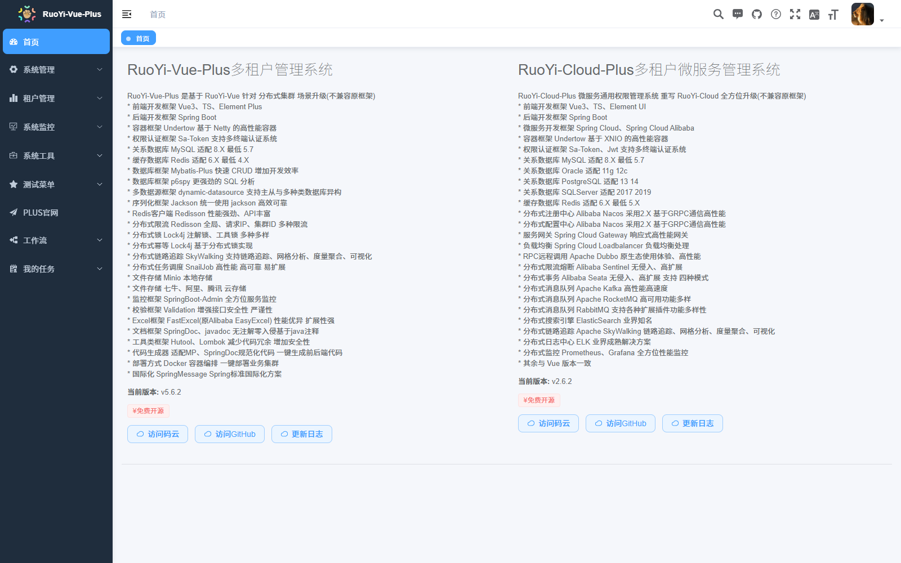
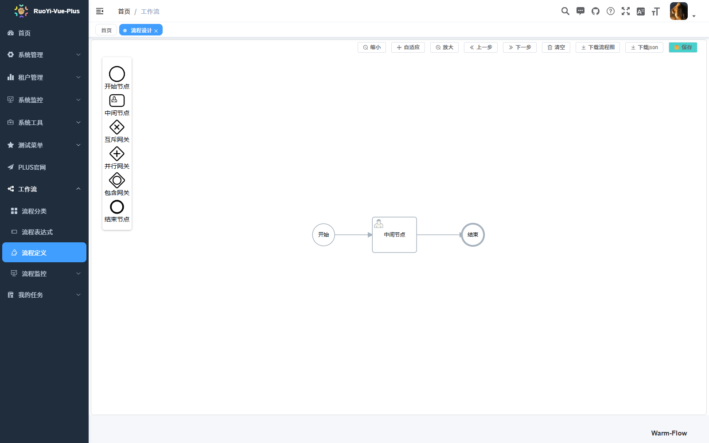

# 证据：前端已有功能巡检（真实浏览器 + 真实后端）

- **日期**：2026-11-01
- **方式**：Headless Edge（puppeteer-core 驱动本机 msedge.exe，未下载浏览器）→ `http://localhost`（nginx）→ backend:8080 → MySQL/Redis
- **前置**：`deploy/docker-compose.yml` 四容器已起；**未修改前端代码，未修改后端配置**
- **结论**：菜单内 **31/32 个业务页可直接访问并渲染真实数据**；发现并修复 **1 个真实缺陷**（nginx 配置导致流程设计器整页不可用）。
- **第二轮**：`ruoyi` → `aoyou` 改名后（包名 `com.aoyou`、库名 `aoyou`）整栈重建并**重跑同一套巡检**，结果见 §0。

---

## 0. 改名后复验（2026-11-01，第二轮）

改名完成后 `docker compose down -v` + `up -d --build` 全量重建（新库 `aoyou`），用同一脚本重跑：

```
PASS | 租户选择框不存在（tenant.enable=false 已传导到前端）
PASS | 从 Redis 取到真实验证码 | uuid=da9a5c97... code=12
PASS | 登录接口响应 | 200 {"code":200,"msg":"操作成功","data":{"access_token":"eyJ..."}}
PASS | 登录成功（离开登录页） | http://localhost/index
PASS | 后端返回菜单路由 | 48 条，可访问叶子页 39 个
PASS | 待访问页面分类 | 访问 32 个，跳过 7 个（外部/参数化/iframe）
PASS | 列表页渲染出表格数据 | 30 页有表格行
FAIL | 逐页访问菜单叶子页 | 32 页，异常 1 页
```

| 结果 | 页面数 | 说明 |
|---|---|---|
| ok | 31 | 见 §3 表；含 `/workflow/design/index` —— iframe 指向 `/prod-api/warm-flow-ui/index.html`，**改名后仍正常** |
| BAD | 1 | `/system/log/logininfor`：跳回登录页。原因同 §5（测试侧把 32 次整页刷新打在 `/auth/tenant/list` 的 20 次/60 秒限流上）。**单独复测 2/2 通过**，列表接口 `200 total=3` |
| 跳过 | 7 | 同 §3.1，非缺陷 |

定向复验 `warm-flow-ui` 静态资源（§4 缺陷的回归项）：

```
$ curl -s -o /dev/null -w "%{http_code} %{content_type}
" http://localhost/prod-api/warm-flow-ui/index.html
200 text/html                     # 5816 字节，与直连 :8080 完全一致

$ curl -s -o /dev/null -w "%{http_code} %{content_type} %{size_download}
"     http://localhost/prod-api/warm-flow-ui/js/index-B4cSnZcq.js
200 text/javascript 3199479       # 经 nginx 与直连后端字节数一致
```

---

## 1. 验证方法说明（为什么结果可信）

| 环节 | 做法 |
|---|---|
| 登录 | 走**前端真实加密链路**：页面 JS 用 RSA 加密 AES 密钥 + AES(ECB/PKCS7) 加密报文 → 后端 `CryptoFilter` 解密。未关闭 `api-decrypt`，未改后端 |
| 验证码 | 用页面真实拉取的 `uuid`，从 Redis 键 `global:captcha_codes:<uuid>` 读取答案填入。未关闭 `captcha.enable` |
| 页面覆盖 | 从后端 `/system/menu/getRouters` 取真实菜单树（48 条路由 / 39 个叶子），逐个 `goto` 访问 |
| 判定 | 检查最终 URL、渲染文本长度、表格行数、表单存在性、iframe src、控制台错误、HTTP ≥400 |

> 说明：从 Redis 读验证码是**测试侧取数**，不改变任何生产行为——它证明的是"验证码校验真的在生效"。

## 2. 登录链路（真实加密）

```
PASS 未登录访问 / 被路由守卫重定向到登录页 | http://localhost/login?redirect=/index
PASS 登录页渲染出验证码图片
PASS 登录表单文本输入框（应为 账号/密码/验证码 三项） | 用户名 / 密码 / 验证码
PASS 租户选择框不存在（tenant.enable=false 已传导到前端）
PASS 从 Redis 取到真实验证码 | uuid=... code=5
PASS 登录接口响应 | 200 {"code":200,"msg":"操作成功","data":{"access_token":"eyJ..."}}
PASS 登录成功（离开登录页） | http://localhost/index
PASS 本地已写入 token
```




### 2.1 顺带确认的两件事

- **多租户关闭已传导到前端**：登录页没有租户选择框。`/auth/tenant/list` 返回 `{"tenantEnabled":false,"voList":null}`。
- **`clientid` + `Bearer` 双重校验生效**：缺任一项都 401（详见 `docker-verify.md` §6.3）。

## 3. 逐页访问结果

39 个叶子路由中，跳过 7 个并说明原因，其余 32 个实访。

| 页面 | 路径 | 渲染结果 |
|---|---|---|
| 用户管理 | /system/user | 表格 3 行 + 查询表单 |
| 角色管理 | /system/role | 3 行 |
| 菜单管理 | /system/menu | 8 行 |
| 部门管理 | /system/dept | 10 行 |
| 岗位管理 | /system/post | 4 行 |
| 字典管理 | /system/dict | 13 行 |
| 参数设置 | /system/config | 5 行 |
| 通知公告 | /system/notice | 2 行 |
| 操作日志 | /system/log/operlog | 0 行（无数据） |
| 登录日志 | /system/log/logininfor | 10 行（见 §5 说明） |
| 文件配置管理 | /system/oss-config/index | 5 行 |
| 文件管理 | /system/oss | 0 行（无数据） |
| 客户端管理 | /system/client | 2 行 |
| 租户管理 | /tenant/tenant | 0 行（多租户已关，无数据） |
| 租户套餐管理 | /tenant/tenantPackage | 0 行 |
| 在线用户 | /monitor/online | 7 行 |
| 缓存监控 | /monitor/cache | 图表页（无表格） |
| 代码生成 | /tool/gen | 0 行（未导入表） |
| 测试单表 | /demo/demo | 10 行 |
| 测试树表 | /demo/tree | 13 行 |
| 请假申请 | /demo/leave | 0 行 |
| 流程分类 | /workflow/category | 10 行 |
| 流程表达式 | /workflow/spel | 2 行 |
| 流程定义 | /workflow/processDefinition | 0 行 |
| 流程实例 | /workflow/processMonitor/processInstance | 0 行 |
| 待办任务 | /workflow/processMonitor/allTaskWaiting | 0 行 |
| **流程设计** | /workflow/design/index | iframe 完整渲染（**修复后**，见 §4） |
| 请假申请 | /workflow/leaveEdit/index | 表单页 |
| 我发起的 | /task/myDocument | 0 行 |
| 我的待办 | /task/taskWaiting | 0 行 |
| 我的已办 | /task/taskFinish | 0 行 |
| 我的抄送 | /task/taskCopyList | 0 行 |

**30 个页面渲染出表格结构，控制台无错误，无 HTTP ≥400。**

### 3.1 跳过的 7 个（非缺陷）

| 路由 | 原因 |
|---|---|
| `/system/user-auth/role/:userId`<br>`/system/role-auth/user/:roleId`<br>`/system/dict-data/index/:dictId`<br>`/tool/gen-edit/index/:tableId` | 带路径参数的详情页，必须从列表页带 id 进入，直接访问会传字面量 `:userId` |
| `/monitor/Admin` | iframe 指向 `VITE_APP_MONITOR_ADMIN=/admin/applications`（SpringBootAdmin），本次未部署 |
| `/monitor/snailjob` | iframe 指向 `VITE_APP_SNAILJOB_ADMIN=/snail-job`（SnailJob 控制台），本次未部署 |
| `/https:/gitee.com/dromara/RuoYi-Vue-Plus` | 外链菜单，非站内路由 |

## 4. 发现的真实缺陷（已修复）

### 4.1 现象

`/workflow/design/index`（流程设计）整页空白，控制台：

```
404 GET http://localhost/prod-api/warm-flow-ui/css/index-DXtPEP5S.css
404 GET http://localhost/prod-api/warm-flow-ui/js/index-B4cSnZcq.js
```

### 4.2 定位过程

1. 先怀疑"资源缺失"——资源其实**在 jar 里**：
   `warm-flow-plugin-vue3-ui-1.8.5.jar!/META-INF/resources/warm-flow-ui/`，文件名与 404 的完全一致。
2. 直连后端绕过 nginx：
   `docker exec awp-frontend wget http://backend:8080/warm-flow-ui/index.html` → **200 OK**；
   `.../css/index-DXtPEP5S.css` → **200 OK**。
3. 结论：**问题在 nginx，不在后端。**

### 4.3 根因

`deploy/nginx/default.conf` 里静态资源缓存用了正则 location：

```nginx
location ~* \.(js|css|png|jpg|jpeg|gif|ico|svg|woff2?)$ {
    expires 7d;
    try_files $uri =404;      # 去本地静态目录找，找不到就 404
}
```

nginx 的**正则 location 优先级高于普通前缀 location**。于是 `/prod-api/warm-flow-ui/js/xxx.js`
这类"以静态后缀结尾的接口请求"被这条正则截走，`try_files` 去 `/usr/share/nginx/html/` 下找，自然 404。

### 4.4 修复

给 API 前缀加 `^~`，让前缀匹配优先于正则：

```nginx
location ^~ /prod-api/ {
    proxy_pass http://backend:8080/;
    ...
}
```

### 4.5 修复后验证

```
/prod-api/warm-flow-ui/index.html                200 5816B
/prod-api/warm-flow-ui/css/index-DXtPEP5S.css    200 381646B
/prod-api/warm-flow-ui/js/index-B4cSnZcq.js      200 3199479B
/prod-api/auth/code                              200 4839B
```

流程设计器完整渲染（节点面板 / 工具栏 / 画布 / "Warm-Flow" 标识）：



---

## 5. 未通过 / 需说明的项（如实记录）

### 5.1 `/system/log/logininfor` 在批量巡检中偶发跳登录

- 现象：批量整页刷新巡检时，该页最终 URL 变成 `/login?redirect=/system/log/logininfor`，
  但**页面内容已渲染出 10 行真实登录日志**。
- 单独复测 3 次：**3/3 正常**（URL 正确、8 行数据、无 4xx）。
- 控制台曾捕获 `Error: 访问过于频繁，请稍候再试`（来自 `initTenantList` → `/auth/tenant/list`）。
- 判断：**巡检脚本副作用，非页面缺陷**。成因是连续 32 次整页刷新，每次重建 SPA 与 SSE 连接，
  叠加 `/auth/tenant/list` 的 20/60s 限流配额；真实用户走 SPA 内跳转只加载一次，不会触发。
- **未做**：没有为它改后端限流配置（那会掩盖问题），只在脚本侧清限流键并重试一次。

### 5.2 明确未覆盖

| 项 | 状态 |
|---|---|
| 新增 / 编辑 / 删除等写操作 | **未验证**（本次只读巡检，未向业务表写数据） |
| 导入导出、文件上传（OSS） | 未验证，需对象存储配置 |
| 流程发起 / 审批流转 | 未验证，无流程定义数据 |
| 代码生成器实际生成 | 未验证 |
| 浏览器兼容性（Chrome/Firefox/Safari） | 仅 Edge（Chromium） |
| 移动端 / 响应式 | 未验证 |
| 权限差异（非 admin 角色） | 仅验证 admin 全权限；未验证越权拦截 |
| i18n 切换 | 未验证 |

---

## 6. 复现

巡检脚本位于仓库外的 `D:\workstation\_awp_verify\`（不入库，避免污染 `frontend/` 接缝）：

```bash
cd D:/workstation/_awp_verify
node e2e.mjs          # 全量巡检，输出 out/report.json + 截图
node probe-design.mjs # 流程设计器专项
```

依赖：`puppeteer-core` + 本机 Edge（`C:\Program Files (x86)\Microsoft\Edge\Application\msedge.exe`）。
